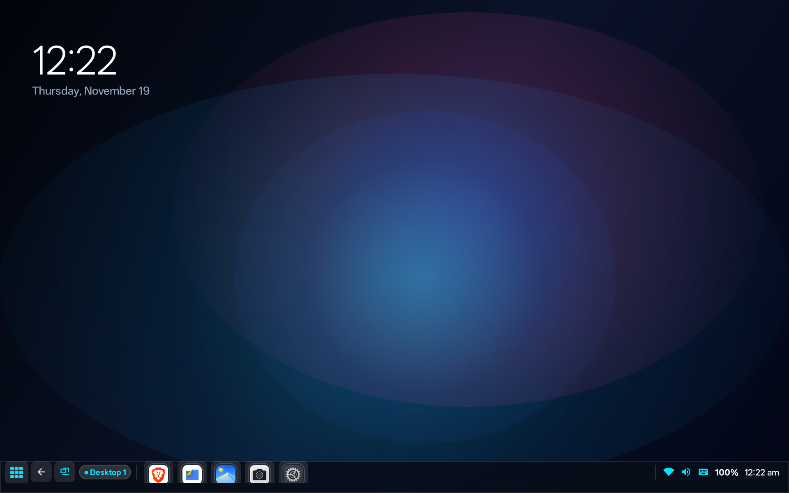
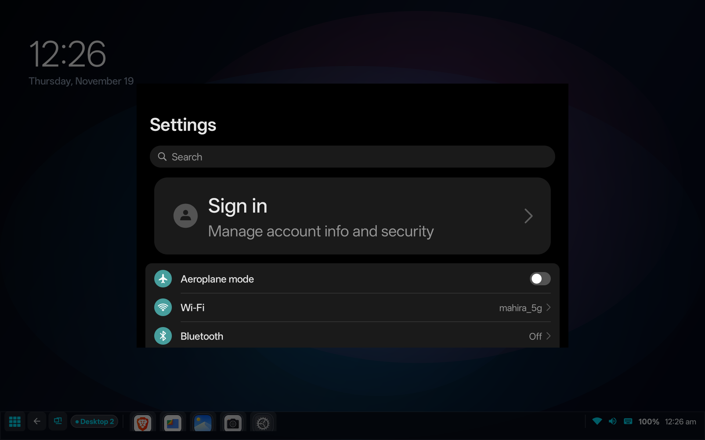
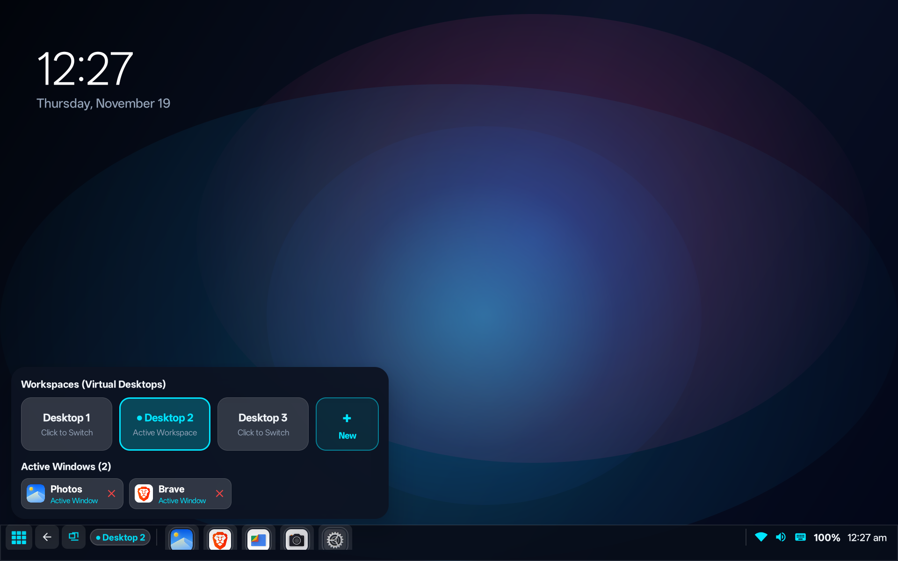
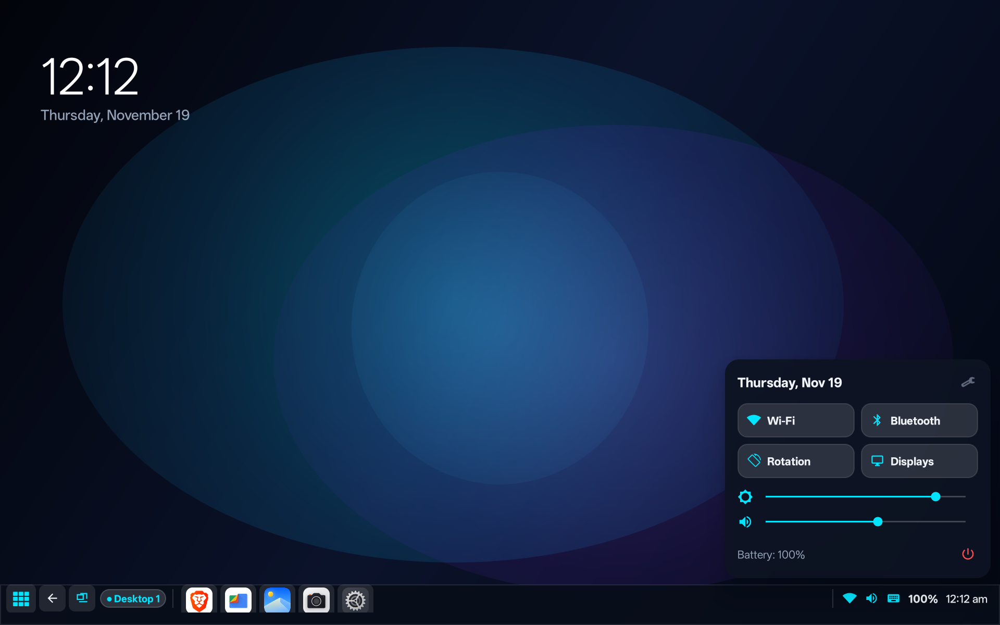
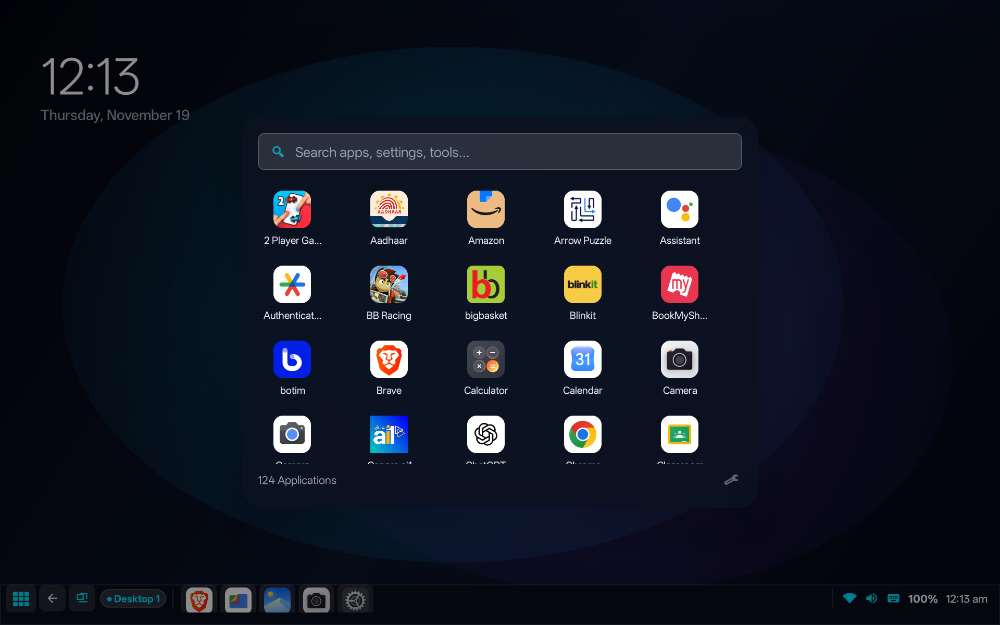

# OpenDeX 🌌
### Universal Open-Source Android Desktop Environment & Multi-Window Workstation

[](LICENSE)
[](https://developer.android.com)
[](https://kotlinlang.org)
[](https://source.android.com)

**OpenDeX** (Open Desktop Experience) turns any modern Android smartphone or tablet into a high-performance, clutter-free desktop workstation. Powered exclusively by standard Android Open Source Project (AOSP) multi-window APIs, OpenDeX delivers resizable floating windows, virtual desktop spaces, persistent overlay navigation, and peripheral optimization without proprietary vendor lock-in, root permissions, or custom ROMs.

---

## 📸 Desktop Visual Showcase

| Clean Desktop & Living Clock | Multi-Window Freeform Floating |
| :---: | :---: |
|  |  |

| Task View & Virtual Workspaces | Quick Control Center |
| :---: | :---: |
|  |  |

| Fullscreen Blurred App Launcher |
| :---: |
|  |

---

## ⚡ Core Architecture: How OpenDeX Works Under the Hood

### 1. AOSP Freeform Windowing (`WINDOWING_MODE_FREEFORM = 5`)
Unlike traditional Android launchers that operate strictly in single-app fullscreen mode, OpenDeX leverages AOSP's native window manager:
* Every application launch configures `ActivityOptions.setLaunchWindowingMode(5)`.
* Precision launch bounds (`options.setLaunchBounds(Rect)`) enforce true desktop aspect ratios (16:10 / 16:9) centered on the display canvas, leaving the bottom 52dp taskbar unobstructed.
* Android's `WindowManagerService` runs each application as an independent floating surface container, enabling true simultaneous execution and side-by-side multitasking.

### 2. Multi-Display Dynamic Routing (`DisplayManager`)
OpenDeX continuously detects monitor connectivity via `DisplayManager.DisplayListener`:
* **Secondary Display Isolation:** When connected to an external screen (USB-C DisplayPort, wireless cast, or scrcpy virtual display), OpenDeX isolates its workspace to the external target display via `ActivityOptions.setLaunchDisplayId(targetDisplayId)`.
* **Phone Stays Free:** Your smartphone's built-in screen can continue to display your phone homescreen or run separate tasks while your monitor runs the full desktop canvas.

### 3. Persistent Overlay Taskbar (`TaskbarOverlayService`)
When third-party apps enter fullscreen or maximize:
* `TaskbarOverlayService` utilizes `WindowManager.LayoutParams.TYPE_APPLICATION_OVERLAY`.
* By binding directly to the secondary display's display context (`createDisplayContext(targetDisplay)`), the taskbar floats seamlessly over maximized applications specifically on the monitor, providing instant Back navigation, Start Menu access, and virtual desktop switching without covering the phone screen.

---

## 🖥️ Feature Highlights

### 🌌 1. Virtual Desktops (Workspaces)
* **Unlimited Workspaces:** Create and organize multiple virtual desktops (`Desktop 1`, `Desktop 2`, `Desktop 3`, etc.) to separate gaming, coding, web browsing, and office productivity.
* **Silky Smooth Slide Transitions:** Switching workspaces triggers an animated horizontal slide with wallpaper parallax displacement and a centered glassmorphic HUD badge.
* **Fluid Gestures:**
  * **Swipe on Desktop:** 1-finger horizontal swipe across any open desktop wallpaper area instantly slides between desktops.
  * **3-Finger Trackpad / Screen Swipe:** 3-finger horizontal gesture triggers workspace switching from anywhere on the display.
  * **Taskbar Pill & Button:** 1-tap on the desktop badge pill or Virtual Desktops icon immediately opens the workspace switcher.

### 🪟 2. Task View ("Show Windows")
* Tap the Task View icon in the taskbar to inspect all active windows currently running on the active desktop.
* Each running window displays its native application icon, active status ("Active Window" / "Minimized"), and an instant **`X` close button** to terminate background tasks.
* 1-click on any window card instantly unminimizes and restores focus to that window.

### 🔲 3. Normalized Dock Icons (Squircle Framework)
* **The Visual Discrepancy Problem:** Third-party Android APKs come with mismatched asset styles. Some apps (e.g., modern system utilities) provide transparent adaptive vectors, while others (e.g., Brave, banking, and commerce apps) bundle rigid, opaque white rectangular bitmaps that create harsh visual contrast.
* **The OpenDeX Solution:** OpenDeX wraps every dock and taskbar icon in a standardized squircle backdrop (`bg_dock_squircle.xml` — 38dp frosted glass tile with 11dp curvature and subtle inset padding). This normalizes all third-party app icons into a unified, elegant visual hierarchy.

### 🔔 4. Notifications & Incoming Phone Calls
* **Notifications Center:** Tap the Notification Bell icon in the system tray to instantly pull down the native Android Notification Panel (`EXPAND_STATUS_BAR`). High-priority notifications from messaging apps (WhatsApp, Telegram, Slack, Gmail) float at the top as interactive Heads-Up notification cards.
* **Incoming Calls:** When your phone rings while connected to a monitor, Android's Telecom subsystem routes a high-priority Heads-Up Incoming Call banner to the desktop display. You can answer on speaker/headset, decline, or quick-reply directly from your monitor without picking up your phone.

### 🎨 5. Deep Space & Ambient Wallpapers
* Includes a built-in gallery of high-definition procedural wallpapers:
  * **Celestial Hyper Space** (Default deep midnight gradient with cyan & magenta horizon flares)
  * **Cosmic Sequoia**
  * **Azure Bloom**
  * **Aurora Borealis**
  * **Cyberpunk Midnight**
  * **Slate Nebula**
  * **Deep Emerald & Sapphire Abyss**
* **Custom Storage Wallpapers:** 1-click import from local storage or photo galleries.

---

## 🚀 Quick Start Guide

### Hardware Options
1. **USB-C to HDMI / DisplayPort Cable:** Direct plug-and-play into any external monitor or TV (devices supporting DisplayPort Alternate Mode).
2. **Laptop / PC via scrcpy (Virtual High-DPI Desktop):**
   Connect your Android phone to your PC via USB and run:
   ```bash
   scrcpy --new-display=1920x1200/240 --window-title="OpenDeX Desktop" --stay-awake
   ```
3. **Wireless Display (Cast / Miracast):** Connect via "Screen Cast" in Android quick settings.

### Android Developer Options Setup (One-Time)
To allow standard AOSP multi-windowing on devices where OEM vendors keep it disabled by default:
1. Open phone **Settings** -> **About Phone** -> Tap **Build Number** 7 times to enable Developer Options.
2. In **Developer Options**, toggle ON:
   * **Enable freeform windows** (`enable_freeform_support`)
   * **Force activities to be resizable** (`force_resizable_activities`)
3. Alternatively, enable instantly via ADB:
   ```bash
   adb shell settings put global enable_freeform_support 1
   adb shell settings put global force_resizable_activities 1
   ```

### Building From Source
```bash
# 1. Clone repository
git clone https://github.com/cosmicbyt123/Opendex.git
cd Opendex

# 2. Compile Debug APK
./gradlew assembleDebug

# 3. Install to connected device
adb install -r app/build/outputs/apk/debug/app-debug.apk

# 4. Launch OpenDeX on primary or secondary display
adb shell am start -n com.cosmic.opendex/.MainActivity
```

---

## ⌨️ Desktop Shortcuts & Gestures

| Action | Mouse / Keyboard | Touchscreen |
| :--- | :--- | :--- |
| **Open App Drawer** | Click 9-Dot Launcher icon or `Super` / `Windows` key | Tap 9-Dot Taskbar button |
| **Switch Desktops** | Mouse drag horizontally on wallpaper | 1-finger horizontal swipe on wallpaper or 3-finger swipe |
| **Task View (Show Windows)** | Click Task View button in taskbar | Tap Task View button in taskbar |
| **Virtual Keyboard** | Click Keyboard icon in system tray | Tap Keyboard icon in system tray |
| **Notifications** | Click Notification Bell in system tray | Tap Notification Bell in system tray |
| **Pin / Unpin App** | Drag app icon from drawer to taskbar | Long-press & drag app icon to dock |
| **Quick Settings** | Click System Tray (Clock/Battery/Wi-Fi) | Tap System Tray |

---

## ⚖️ Legal & Trademark Notice

* **OpenDeX** is an independent, community-driven open-source project.
* "DeX" in OpenDeX is an acronym for **Desktop Experience**.
* This project is not affiliated with, endorsed by, sponsored by, or associated with Samsung Electronics Co., Ltd., Lenovo Group Limited, or Google LLC.
* All trademarks, product names, and company logos referenced herein belong to their respective owners. OpenDeX utilizes only public, standard Android Open Source Project (AOSP) platform APIs.

---

## 📄 License
This project is licensed under the [MIT License](LICENSE). Contributions, bug reports, and pull requests are warmly welcomed!
